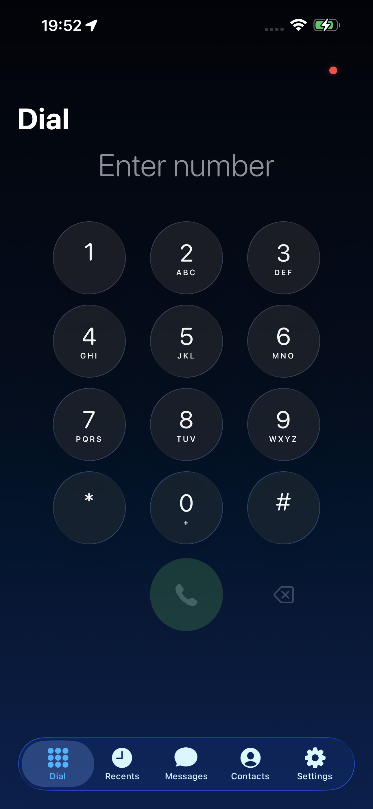
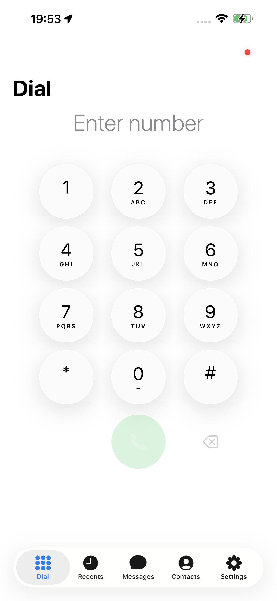
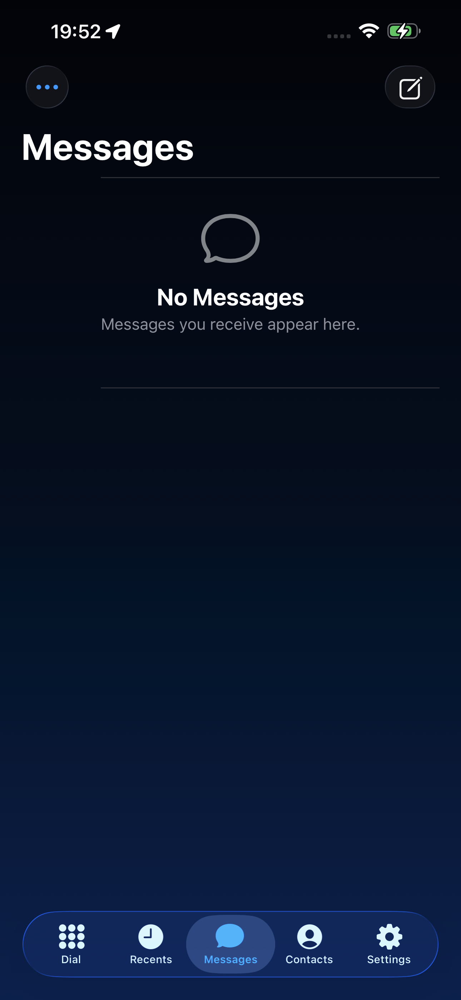
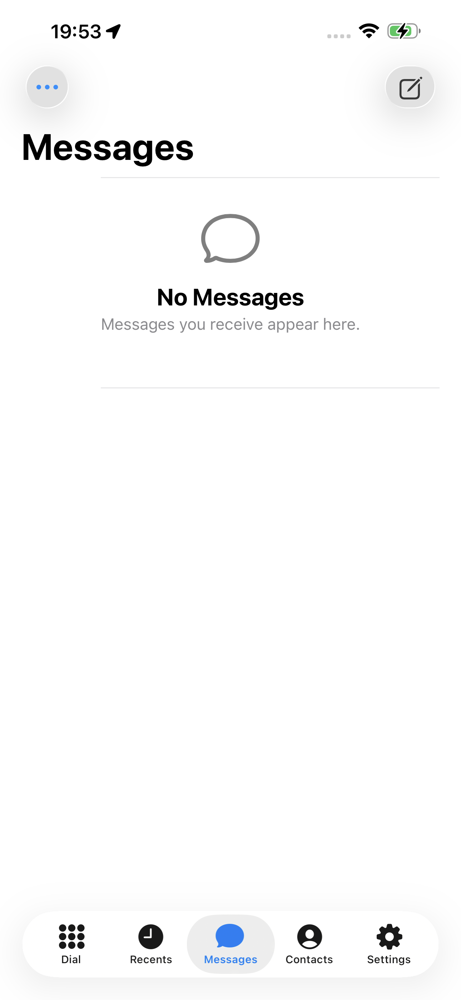
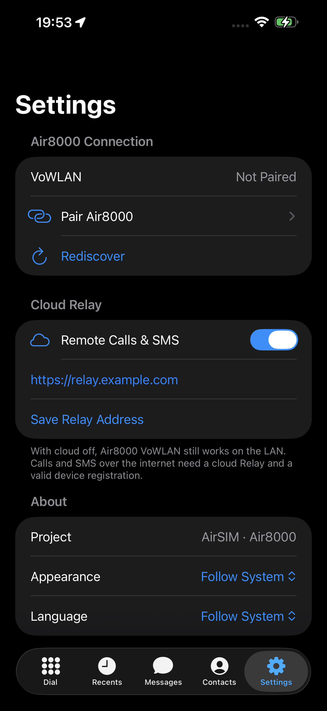
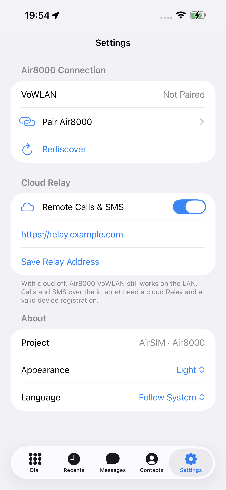

# AirSIM iOS app (xtool)

The iPhone client for AirSIM: dial pad, recents, SMS, contacts and settings,
with CallKit, PushKit and Live Activity support. It talks to the Air8000A over
VoWLAN on the same Wi-Fi, or through a cloud Relay
([`push-relay-worker`](../push-relay-worker/README.md) or the
[VPS gateway](../tools/air8000-vps/README.md#ios-app-cloud-relay)) when away.

It is a SwiftPM package built with [xtool](https://github.com/xtool-org/xtool),
so it builds and installs from Linux or WSL without Xcode.

| Dark | Light |
| --- | --- |
|  |  |
|  |  |
|  |  |

More in [`docs/screenshots`](docs/screenshots).

## Layout

| Path | Role |
| --- | --- |
| `Sources/AirSIM/` | App sources (SwiftUI, CallKit, PushKit, VoWLAN, cloud media) |
| `Package.swift` | SwiftPM package; links with iOS SDK 26 so Liquid Glass is enabled |
| `xtool.yml` | Bundle ID, Info.plist, entitlements, icon and icon resources |
| `AirSIM-Info.plist` | Info.plist, including the light/dark icon declarations |
| `AirSIM.entitlements` | App entitlements |
| `Icons/` | Light and dark app icons (loose PNGs) |

## Build and install

On a Linux machine with xtool set up and the iPhone connected:

```sh
cd AirSIM-xtool/AirSIMXtool
xtool dev
```

`com.example.airsim.xtool` in `xtool.yml` is a placeholder. Set your own unique
Bundle ID first, and use the same main Bundle ID as the Relay's
`ALLOWED_BUNDLE_ID`. Debug builds get APNs sandbox tokens; TestFlight and App
Store builds get production tokens.

## Notes

- **Liquid Glass.** xtool on Linux records the deployment target (iOS 17) as
  the SDK version, which makes iOS run the app in compatibility mode without
  Liquid Glass. `Package.swift` passes `-platform_version ios 17.0 26.0` to the
  linker to fix that. Raise `26.0` if your xtool SDK is newer.
- **Languages.** The UI follows the system language (Chinese or English) and can
  be overridden in Settings. Strings go through `L10n.t(_:)`; English text lives
  in `L10nEnglish.swift`, keyed by the Chinese source text.
- **Dark-mode icon.** xtool can't compile an `Assets.car`, so the dark icon is
  an alternate icon that the app switches to when its appearance is dark. iOS
  shows a confirmation alert on each switch and can only switch while the app
  is open. Tinted home-screen icons aren't supported.
- The Apple Watch app and Live Activity widget extension from the former Xcode
  project are not part of this package yet.
