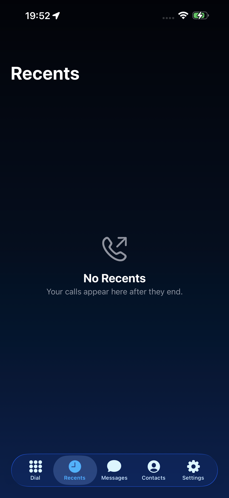
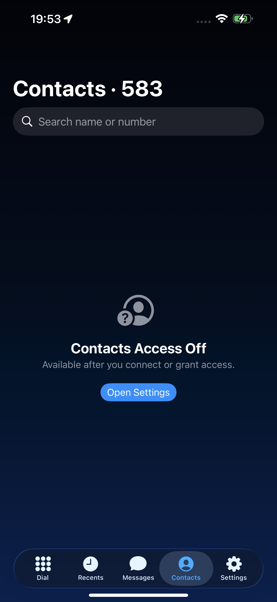
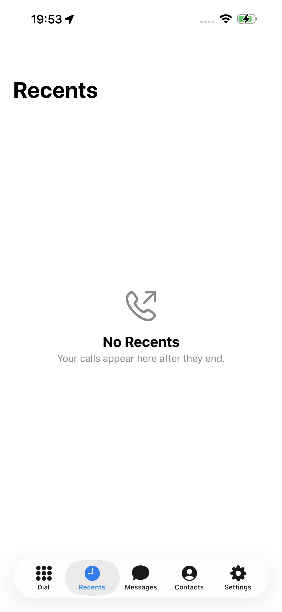
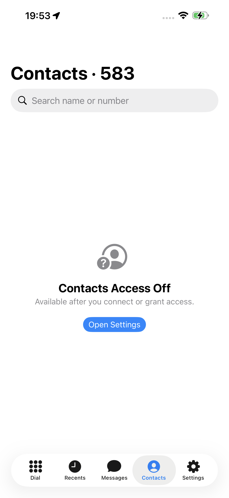

# AirSIM

AirSIM connects an Air8000A cellular endpoint, iPhone and Apple Watch for calls, SMS and remote control. The Air8000A backend is the active hardware path. The former Samsung Android client has been removed; it remains in Git history before this change.

AirSIM is source-available software for personal learning, research and other non-commercial use. It is licensed under [PolyForm Noncommercial 1.0.0](LICENSE), not the OSI Open Source Definition. Do not use it for commercial services or emergency communications.

## Screenshots

The iPhone app in dark and light mode, with a Liquid Glass tab bar and English or Chinese UI.

<p align="center">
  
  
  
  
  
</p>
<p align="center">
  
  
  
  
  
</p>

## What is in this repository

| Path | Role |
| --- | --- |
| [`air8000`](air8000/README.md) | LuatOS Air8000A firmware: cellular calls, SMS, GNSS, Wi-Fi, WebSocket, media and provisioning |
| [`AirSIM-xtool`](AirSIM-xtool/README.md) | iPhone client (SwiftPM + xtool, builds on Linux): CallKit, PushKit, VoWLAN, SMS and Live Activity |
| [`push-relay-worker`](push-relay-worker/README.md) | Optional Cloudflare Worker relay, APNs, queues, dashboard and WebSocket media |
| [`tools/air8000-vps`](tools/air8000-vps/README.md) | Air8000 LAN/VPS gateway, browser control panel and iOS cloud Relay API |
| [`docs`](docs) | Protocol, architecture, provisioning, flashing and test notes |

## Architecture

The preferred path is:

```text
iPhone / Apple Watch
        │ authenticated LAN WebSocket or optional Relay
        ▼
Air8000A ── cellular calls, SMS, GNSS and media
```

The Air8000 protocol is versioned as `airsim.air8000.v1`. The protocol definition and test vectors are [here](docs/protocol/airsim-air8000-v1.md) and [here](docs/protocol/test-vectors.json). The `v1` name is a live protocol contract, not an obsolete backup.

## Quick start

### Air8000A

1. Copy `air8000/config.example.lua` to an ignored `air8000/config.lua` and fill in device-local values.
2. Run `powershell -File air8000/tools/package.ps1` on Windows, or `sh air8000/tools/package.sh` on macOS/Linux.
3. Open the generated bundle in LuatTools and select the Air8000A firmware family 113 target.
4. Provision Wi-Fi over BLE or use the authenticated LAN gateway.

Read [`air8000/README.md`](air8000/README.md), [`docs/AIR8000_BUILD.md`](docs/AIR8000_BUILD.md), [`docs/AIR8000_PROVISIONING.md`](docs/AIR8000_PROVISIONING.md) and [`docs/AIR8000_TESTING.md`](docs/AIR8000_TESTING.md) before connecting real hardware.

### iPhone and Apple Watch

Build `AirSIM-xtool/AirSIMXtool` with [xtool](https://github.com/xtool-org/xtool) on Linux or WSL (`xtool dev`); see [`AirSIM-xtool/README.md`](AirSIM-xtool/README.md). Replace the placeholder `com.example.airsim.xtool` with a unique Bundle ID controlled by the deployer. Use the matching APNs sandbox or production environment; never reuse another developer's signing identity.

### Optional Relay

```sh
cd push-relay-worker
npm ci
cp wrangler.example.toml wrangler.toml
npm test
npm run check
npx wrangler deploy --dry-run --config wrangler.toml
```

Use the deployer's own Cloudflare account, KV, Durable Objects and domain. `APNS_P8` and `DASHBOARD_TOKEN` are Worker Secrets, not variables, source files or build output. A dry run is not a deployment.

## Security boundaries

- Gateway admin, SIP and RTP ports stay private; only the HTTPS/WSS hostnames are public.
- VoWLAN requests retain timestamp, nonce, HMAC, route allowlists and size limits.
- Call PCM is memory-only; logs must not contain PCM, complete SMS, Push tokens or secrets.
- Emergency calls remain the responsibility of the operating system and carrier phone service.

Never commit APNs keys, Cloudflare tokens, device secrets, Agent tokens, HMAC keys, signing keys, certificates, profiles, real phone numbers or message contents.

## Validation

Run the smallest set matching the change. For a full pre-release check:

```sh
(cd push-relay-worker && npm test && npm run check)
(cd tools/air8000-vps && npm test)
# iOS app: (cd AirSIM-xtool/AirSIMXtool && xtool dev) on a Linux machine with xtool
```

Automated checks do not prove carrier VoLTE, real two-way audio, APNs production delivery, Watch background behavior, target-phone compatibility or Relay production readiness. Those require the deployer's own devices, accounts, signing assets and network.

## Documentation

- [Air8000 architecture](docs/AIR8000_ARCHITECTURE.md)
- [Air8000 protocol](docs/AIR8000_PROTOCOL.md)
- [Air8000 flashing](docs/AIR8000_FLASH.md)
- [Air8000 testing](docs/AIR8000_TESTING.md)
- [VoWLAN design](docs/2026-09-11-vowlan-design.md)
- [Samsung hotspot pairing protocol](docs/samsung-hotspot-pairing-protocol.md)
- [Codex deployment guidance](codex.md)
- [General LLM project contract](LLM.txt)

## License

Keep [LICENSE](LICENSE), [NOTICE](NOTICE) and [THIRD_PARTY_NOTICES.md](THIRD_PARTY_NOTICES.md) with every permitted non-commercial redistribution. Third-party components retain their own licenses.
